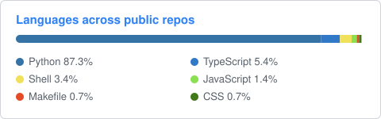

# Chris Hickman

### IAM / Platform Engineer

Identity as a control plane: least privilege, just-in-time and privileged access, non-human identities, and catching drift before it turns into exposure.

## About

I'm an IT and identity security professional with hands-on work across IAM. I treat identity as a control plane: least privilege, just-in-time and privileged access, non-human identities, and catching drift before it turns into exposure. Lately that includes AI agents, which I think need the same isolation and least privilege as any other identity. These are the labs and tools I build to work through those problems.

I work on projects when time allows, and on whatever has my interest at the moment.

## Tech stack

## Featured projects

| Project | What it is | Status |
| --- | --- | --- |
| [**Lab-in-a-Box**](https://github.com/chriswayneh/lab-in-a-box) | Self-hosted identity governance lab with Keycloak, Vault, and Gitea |    |
| [**Local MCP Toolbox**](https://github.com/chriswayneh/local-mcp-toolbox) | Read-only MCP server with allowlists, redaction, and audit records |    |
| [**crowdkeeper**](https://github.com/chriswayneh/crowdkeeper) | Access audits and joiner, mover, leaver automation for Atlassian Crowd |    |
| [**acasentry**](https://github.com/chriswayneh/acasentry) | Access and identity review for Azure Container Apps |    |
| [**kube-foundry**](https://github.com/chriswayneh/kube-foundry) | Local Kubernetes platform with GitOps, policies, and tested rollback |    |
| [**detdrift**](https://github.com/chriswayneh/detdrift) | Flags detection rules broken by telemetry schema changes |    |
| [**RedDock**](https://github.com/chriswayneh/RedDock) | Local scoped discovery and evidence tool for authorized environments (in progress) |    |
| [**TerraForma-IaC**](https://github.com/chriswayneh/TerraForma-IaC) | Generates readable Terraform from guided inputs; does not deploy |    |
| [**bbwarden**](https://github.com/chriswayneh/bbwarden) | Least-privilege and offboarding review for Bitbucket Cloud and Data Center |    |
| [**Linchpin**](https://github.com/chriswayneh/linchpin) | Read-only identity review across Entra ID, Okta, Crowd, and Bitbucket exports: admins without MFA, stale accounts, leavers still active |    |

## Recently shipped

<!-- RECENT:START -->
- [linchpin v0.2.1](https://github.com/chriswayneh/linchpin/releases/tag/v0.2.1) · 2026-10-15
- [crowdkeeper v0.2.3](https://github.com/chriswayneh/crowdkeeper/releases/tag/v0.2.3) · 2026-10-15
- [bbwarden v0.2.3](https://github.com/chriswayneh/bbwarden/releases/tag/v0.2.3) · 2026-10-15
- [acasentry v0.2.1](https://github.com/chriswayneh/acasentry/releases/tag/v0.2.1) · 2026-10-15
- [TerraForma-IaC v0.3.0](https://github.com/chriswayneh/TerraForma-IaC/releases/tag/v0.3.0) · 2026-10-08
<!-- RECENT:END -->

## Languages

## Other work

**[JobDorking](https://jobdorking.com)** (inactive): one Google search across job boards and company career pages. Not actively worked on; the source is private.
